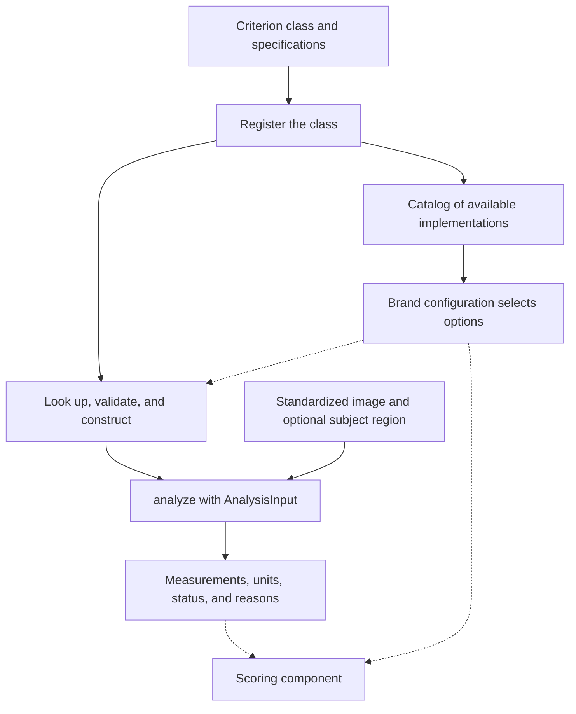

# How to add a CV criterion to BrandLens

This guide describes the **criterion-owned specifications and minimal registry** package supplied for task 8.2a. Apply that complete package before following these examples: the original criterion classes on which it was based did not expose these metadata methods.

Suggested repository location: `docs/how_to_add_a_cv_criterion.md`.

## 1. Understand the workflow

A developer implements a criterion and registers its class. The registry exposes it in the catalog. A brand configuration selects an implementation and its settings. The application then validates that selection, constructs the criterion, and calls `analyze()` on a standardized image. Scoring interprets the measurements separately.

**Registration makes an implementation available. It does not automatically run it or assign a score.**



Dashed arrows mark automatic configuration/pipeline connections still to be implemented in 8.2a/8.2. The registry helpers and manual analysis calls shown below work in the supplied package.

| Implemented in the supplied package | Subsequent integration work |
| --- | --- |
| Criterion specifications and catalog generation | Read and validate the complete brand JSON |
| Criterion/implementation lookup | Update the JSON schema for the proposed selection/settings fields |
| Settings validation through each constructor | Build and run the configured set of CV criteria automatically |
| Requested measurement-name validation | Manage shared subject detection in the pipeline |
| Measurement calculation and automatic result units | Connect outputs to compatible scoring rules and the upload path |

## 2. Keep each responsibility in one place

| Information or behavior | Owner |
| --- | --- |
| Criterion description | Criterion class docstring |
| Settings, defaults, and setting descriptions | Criterion `settings_spec()` |
| Validation of setting values and relationships | Criterion `_validate_settings()` |
| Measurement names, types, units, and nullable values | Criterion `measurement_specs()` |
| Additional input requirements | Criterion `input_requirements()` |
| Calculation | Criterion `analyze()` |
| Available implementation classes | `analysis/registry.py` |
| Lookup, construction, and catalog collection | `analysis/registry_support.py` |
| Brand selection, thresholds, and weights | Brand configuration and scoring component |

`CriterionBase` reads defaults from the settings specification and units from the measurement specification. Its inherited `describe()` collects those specifications and the class docstring. Do not copy the same metadata into the registry.

The specification dictionaries are catalog metadata, not executable JSON Schema. The constructor still calls `_validate_settings()` to enforce values. Runtime output-type and scoring compatibility checks are further integration work; `validate_measurements()` currently checks names only.

## 3. Create the class

Create one file under `src/brandlens/analysis/`, named after the implementation or criterion.

The following **toy example** demonstrates the extension process. It measures the red channel and is not an additional agreed MVP requirement. Save it as `red_channel_criterion.py`:

```python
from math import isfinite
from typing import Any

import numpy as np

from .analysis_input import AnalysisInput
from .criterion_base import CriterionBase


class RedChannelCriterion(CriterionBase):
    """Measure mean red-channel intensity and the high-red pixel fraction.

    Values describe the encoded RGB channel, not physical brightness.
    The high-red cutoff is inclusive. These measurements are not brand scores.
    """

    criterion_id = "red_channel_intensity"
    method_id = "numpy_mean_red"
    method_version = "1"

    @classmethod
    def settings_spec(cls) -> dict[str, Any]:
        return {
            "high_red_min": {
                "type": "number",
                "default": 200,
                "description": "Inclusive high-red cutoff from 0 to 255.",
            }
        }

    @classmethod
    def measurement_specs(cls) -> dict[str, Any]:
        return {
            "mean_red": {"type": "number", "unit": "channel_0_255"},
            "high_red_fraction": {"type": "number", "unit": "fraction_0_1"},
        }

    def _validate_settings(self, settings: dict[str, Any]) -> None:
        value = settings["high_red_min"]
        if isinstance(value, bool) or not isinstance(value, (int, float)):
            raise TypeError("high_red_min must be a number.")
        if not isfinite(value) or not 0 <= value <= 255:
            raise ValueError("high_red_min must be finite and between 0 and 255.")

    def analyze(self, data: AnalysisInput) -> dict[str, Any]:
        if not isinstance(data, AnalysisInput):
            raise TypeError("data must be an AnalysisInput object.")
        data.__post_init__()  # Revalidate the borrowed, mutable Pillow image.
        red = np.asarray(data.image, dtype=np.float64)[..., 0]
        return self._make_result({
            "mean_red": float(np.mean(red)),
            "high_red_fraction": float(
                np.mean(red >= self._settings["high_red_min"])
            ),
        })
```

The inherited constructor reads the defaults, rejects unknown setting names, merges overrides, and calls `_validate_settings()`. A custom constructor is unnecessary for this example.

### Choose the identifiers deliberately

- `criterion_id` identifies **what** is evaluated, such as `exposure_brightness`.
- `method_id` identifies **how** it is measured. Configuration and catalog entries call this `implementation_id`.
- `method_version` records the implementation version used in results.

Two implementations may share a criterion ID. Every registered implementation must have a unique method ID. Reuse a criterion ID only when the alternative evaluates the same criterion; check measurement meanings and units before reusing its scoring rule.

Record algorithm changes with an appropriate implementation ID/version. Do not silently change a measurement's meaning while retaining thresholds calibrated for the old definition.

### If a subject region is required

Override `input_requirements()` in that class:

```python
@classmethod
def input_requirements(cls) -> dict[str, Any]:
    return {**super().input_requirements(), "reliable_subject_region": True}
```

This declares the dependency; it does not run a detector or check the image. `analyze()` must handle a missing or unreliable region explicitly. Follow the existing framing and sharpness classes: return `unavailable_needs_review` with a reason, optionally retaining valid partial measurements.

Subject detection should run once in the pipeline and supply the shared `AnalysisInput` to dependent criteria. Do not embed detector execution inside each measurement class.

## 4. Register the implementation

Edit **only `src/brandlens/analysis/registry.py`** for registration.

Add this import:

```python
from .red_channel_criterion import RedChannelCriterion
```

Then append `RedChannelCriterion,` to the existing tuple passed to `CVRegistry`:

```python
CV_REGISTRY = CVRegistry(
    (
        BrightnessCriterion,
        ContrastCriterion,
        ColorPaletteCriterion,
        SubjectFramingCriterion,
        SubjectSharpnessCriterion,
        RedChannelCriterion,
    )
)
```

Keep the existing public helper assignments below that list. No changes to `registry_support.py` or the other criteria are needed to register this example.

## 5. Inspect the catalog

```python
from brandlens.analysis.registry import get_cv_catalog, get_cv_registration

entry = get_cv_registration("red_channel_intensity", "numpy_mean_red")
print(entry.describe())
catalog = get_cv_catalog()
```

The entry includes the class docstring, setting default `200`, both measurement names and their units, and the standard image requirement. Describing it does not construct a criterion, analyze a sample image, or download model weights. Importing the registered classes still requires the normal CV dependencies.

## 6. Select it in brand configuration

The intended selection fragment is:

```json
{
  "criterion_id": "red_channel_intensity",
  "implementation_id": "numpy_mean_red",
  "method": "cv",
  "settings": {
    "high_red_min": 200
  },
  "required_measurements": [
    "mean_red",
    "high_red_fraction"
  ]
}
```

**This is a proposed fragment, not a complete rubric entry to paste into the current production JSON.** The supplied package did not update `brand_standards.schema.json` or implement its loader. The current schema requires other rubric fields and does not yet permit these new `settings` and `implementation_id` properties.

When implementing the loader, retain the existing brand name, definition, evidence, weights, and evaluation parameters as appropriate. Put only measurement settings in `settings`. Scoring parameters must go to the scoring component rather than being passed into the CV constructor.

Before accepting a configuration, the loader should:

1. Validate the complete JSON structure and selected IDs.
2. Route CV entries to this registry and VLM entries to the model component.
3. Resolve the criterion/implementation pair.
4. Validate the required measurement names.
5. Construct the criterion, which validates its setting values.
6. Check that the selected scoring rule supports the measurements and their meaning.

With multiple implementations for one criterion, supply an explicit implementation ID. The registry rejects an ambiguous selection.

## 7. Run the manual connection now

This code uses the existing helpers directly. It does not claim that automatic JSON loading or upload integration is finished:

```python
import json

from PIL import Image

from brandlens.analysis.analysis_input import AnalysisInput
from brandlens.analysis.registry import get_cv_registration

criterion_config = {
    "criterion_id": "red_channel_intensity",
    "implementation_id": "numpy_mean_red",
    "settings": {"high_red_min": 200},
    "required_measurements": ["mean_red", "high_red_fraction"],
}

entry = get_cv_registration(
    criterion_config["criterion_id"],
    criterion_config["implementation_id"],
)
entry.validate_measurements(criterion_config["required_measurements"])
criterion = entry.create(criterion_config["settings"])

with Image.new("RGB", (2, 1)) as image:
    image.putdata([(255, 10, 20), (0, 30, 40)])
    result = criterion.analyze(AnalysisInput(image))

print(json.dumps(result, indent=2, allow_nan=False))
```

Expected measurements:

```json
{
  "mean_red": 127.5,
  "high_red_fraction": 0.5
}
```

The result also includes the criterion ID, `available` status, implementation/version, resolved settings, units, and reasons. `_make_result()` reads the unit strings from `measurement_specs()` automatically.

For real photographs, pass the preprocessor's standardized image. RGB mode alone does not prove sRGB provenance. A criterion borrows the input: it must not modify its pixels/metadata or close it.

## 8. Verify it and add scoring deliberately

Create `tests/analysis/test_red_channel_criterion.py` with a known-value test:

```python
import unittest

from PIL import Image

from brandlens.analysis.analysis_input import AnalysisInput
from brandlens.analysis.red_channel_criterion import RedChannelCriterion


class TestRedChannelCriterion(unittest.TestCase):
    def test_known_pixels_and_input_preservation(self):
        with Image.new("RGB", (2, 1)) as image:
            image.putdata([(255, 10, 20), (0, 30, 40)])
            image.info["example"] = "keep"
            before = image.tobytes()
            result = RedChannelCriterion().analyze(AnalysisInput(image))
            self.assertEqual(result["measurements"]["mean_red"], 127.5)
            self.assertEqual(result["measurements"]["high_red_fraction"], 0.5)
            self.assertEqual(image.tobytes(), before)
            self.assertEqual(image.info, {"example": "keep"})
```

Also cover meaningful invalid settings, incorrect inputs, and unavailable cases for the real criterion you implement. Verify that requested output names and units match the declared specification. Use a notebook to demonstrate behavior rather than duplicating all unit tests there.

The supplied `test_registry.py` has two inventory assertions that expect five registered implementations. Update those expected counts when intentionally adding another implementation; the generic metadata and lookup checks should continue to apply.

From the repository root:

```bash
PYTHONPATH=src python -m unittest discover -s tests/analysis -p 'test_red_channel_criterion.py' -v
```

Adding a measurement criterion does not create a scoring rule. For a genuinely new criterion such as this example, agree on scoring behavior with the scoring owner. The current engine cannot assign it a supported score just because it appears in the CV registry. A replacement implementation may reuse an existing rule only when its required outputs, units, and definitions are compatible.

## Common mistakes

| Mistake | Correct approach |
| --- | --- |
| Copying units/defaults into the registry | Keep them in the criterion specification |
| Returning an undeclared measurement name | Add its definition to `measurement_specs()` |
| Assuming `type` metadata validates values automatically | Enforce values in `_validate_settings()` |
| Treating `required_measurements` as an output filter | Validate the requested subset and retain other useful measurements |
| Returning zero when a subject cannot be measured | Return an unavailable status and a reason |
| Adding scoring thresholds as measurement settings | Pass them to a compatible scoring rule |
| Renaming an emphasis index to a sharpness ratio | Preserve the mathematical definition; update consumers explicitly |
| Assuming registration enables automatic execution | Select the implementation and connect the configured runner |

The sixth MVP criterion, tone and approachability, belongs to the separate VLM component. It does not need to inherit this CV base class. Both CV and VLM outputs eventually feed the scoring component through their agreed interfaces.
